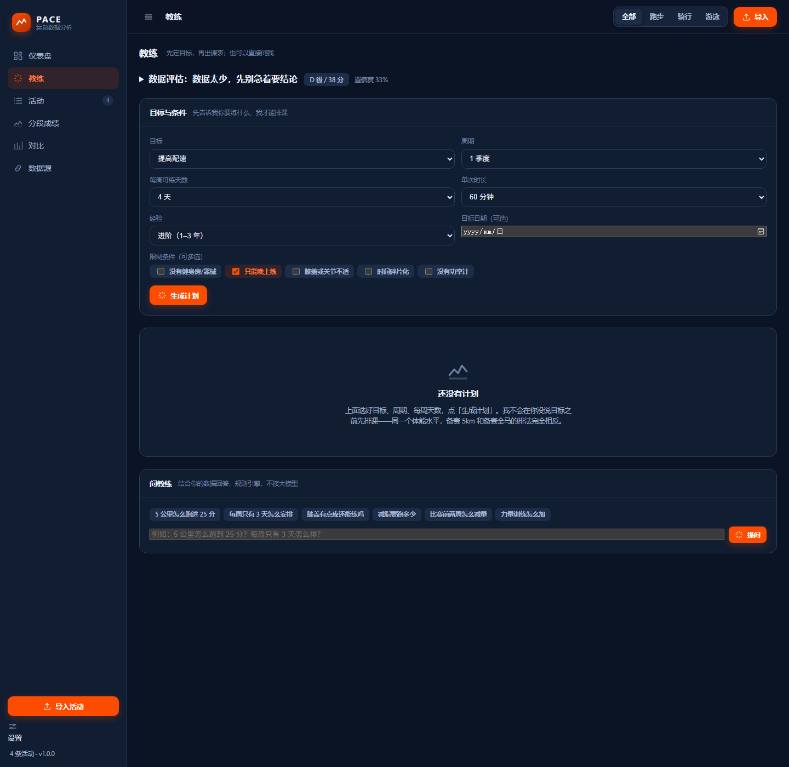
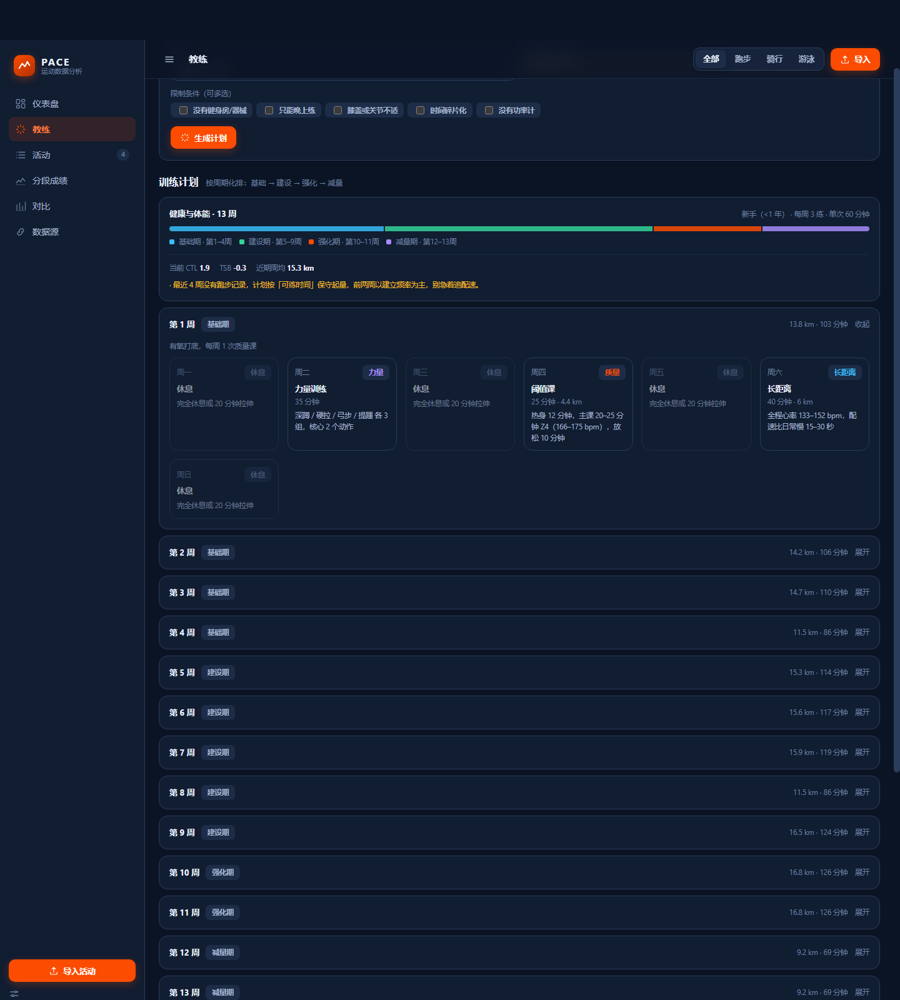
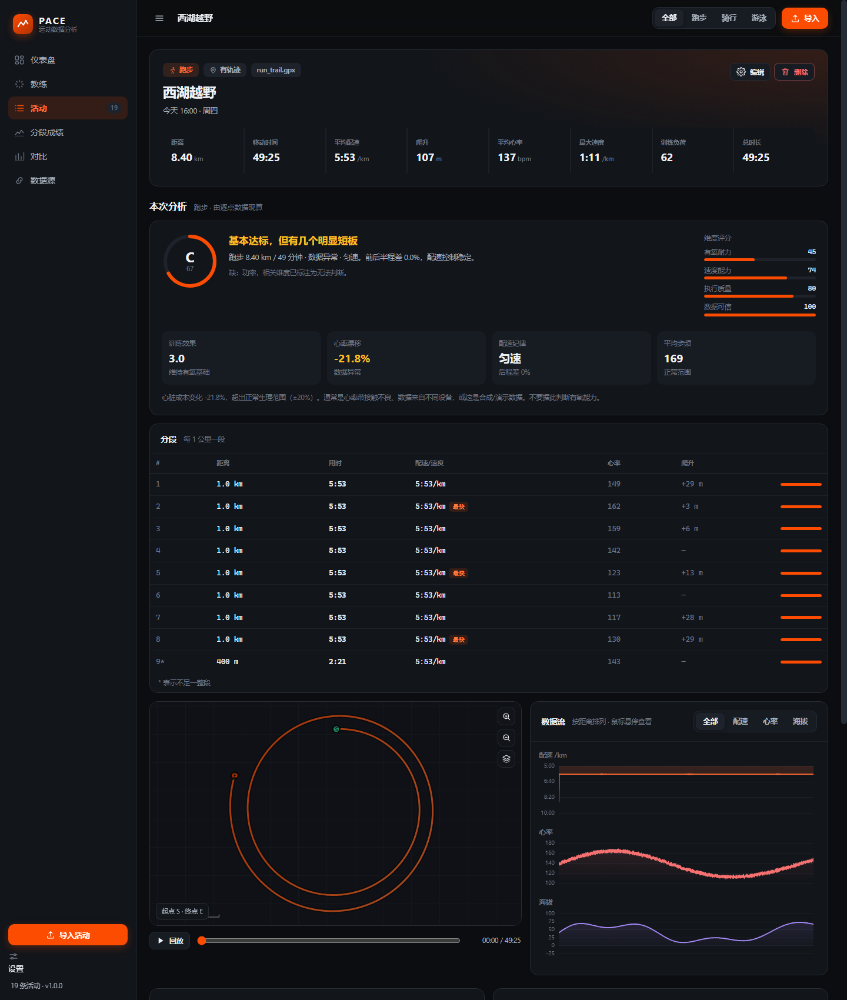
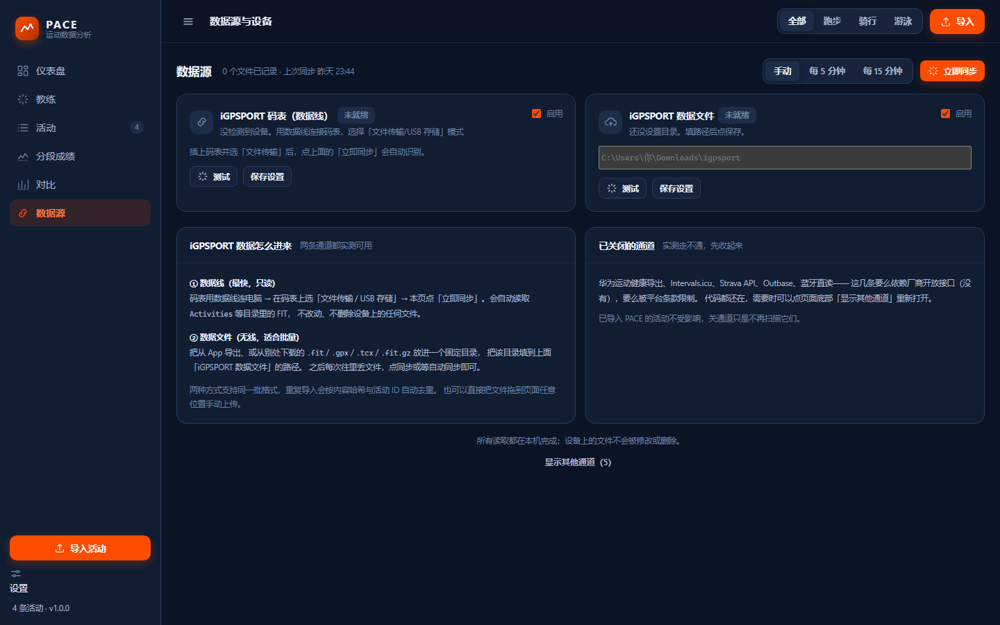
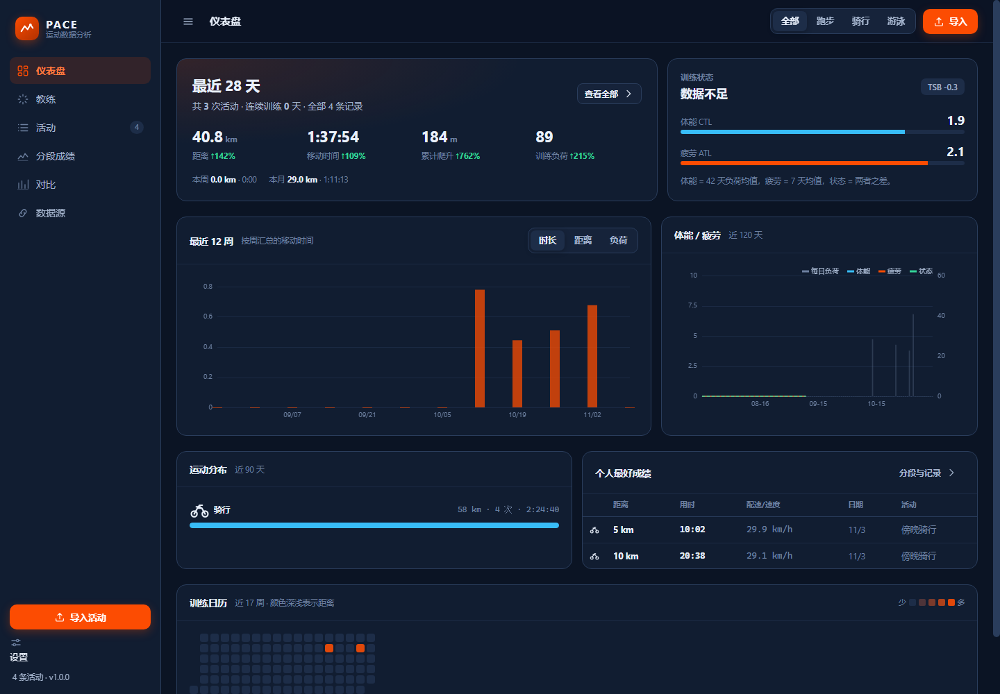
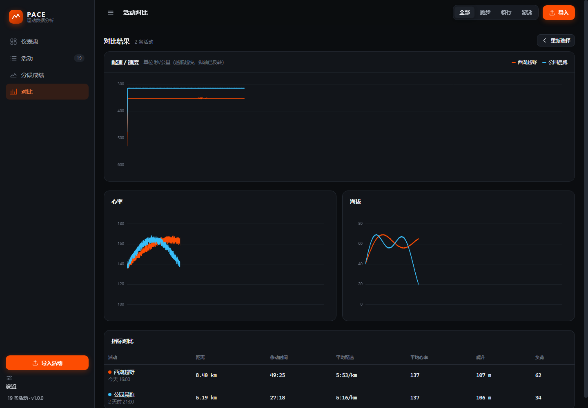

# PACE · 运动数据分析

一个**完全本地运行**的运动数据仪表盘。把 GPX / FIT / TCX / CSV 丢进来，得到
类似 Strava 的活动流、配速分析、心率区间、训练负荷、分段成绩与个人纪录。

- **零第三方依赖**：后端只用 Python 3.11+ 标准库，`pip install` 都不需要
- **数据不出本机**：所有解析与统计在本机完成，存 SQLite 单文件
- **可离线**：地图在拿不到瓦片时自动降级为抽象轨迹图，仍然可看可回放

## 两种用法

- **服务器版**（推荐长期用）：一台小机器 + 账号系统，多人各自独立，数据在服务器。
- **纯前端版**（零成本、手机即开）：<https://lluxingzhe7.github.io/pace/> —— 浏览器里跑 Pyodide + SQLite，
  数据存在本机浏览器（IndexedDB），电脑不用开；代价是首次加载要下 ~10 MB 引擎、多设备不同步、依赖服务器的功能不可用。
  详见 [docs/static-web.md](docs/static-web.md)。

## 账号（多用户）

从 v0.2 起 PACE 自带账号系统，可以给朋友用，各自的数据互不可见。

- **首次打开**：页面会要求创建「站长账号」；如果这台机器上已有旧数据，会自动迁进这个账号。
- **每人独立**：`data/users/<id>/pace.db` 一人一个 SQLite 文件，物理隔离，A 拿不到 B 的活动 ID。
- **会话**：服务端 session（库里只存 token 的 sha256），Cookie 是 `HttpOnly; SameSite=Lax`；默认 14 天，勾「记住我」60 天。
- **密码**：`scrypt`（N=2^14）加盐哈希，改密码后旧会话全部失效。
- **防爆破**：单 IP 15 分钟 5 次、单用户名 20 次失败即暂时锁定。
- **站长权限**：看成员列表、开关注册。
- **单人本机用**：`python run.py --no-auth` 回到旧行为（不建账号，直接读写 `data/pace.db`）。

> 上线到公网请务必先建好账号，并给站点配 HTTPS（Caddy 自动证书），否则 Cookie 会在明文链路上传输。

- **登录方式**：用户名或注册邮箱都可以。
- **找回密码**：登录页 → 忘记密码 → 填注册邮箱 → 邮箱收到 6 位验证码（10 分钟内有效、最多试 5 次、用过即废）→ 重置密码，旧会话全部失效。
  需要在「设置 → 邮件发信」里由站长填 SMTP（QQ 邮箱填授权码）。**没配 SMTP 时**验证码只写进服务端日志；
  本机调试可以用 `PACE_DEV_CODE=1 python run.py`，接口会直接把验证码返回给页面。
- **页面**：`#/login`、`#/register`、`#/forgot`、`#/reset` 四个独立页面，手机宽度下会收成单栏。

## 界面

| 教练 · 目标设置 | 训练计划 |
|---|---|
|  |  |

| 单次分析 | 数据源 |
|---|---|
|  |  |

| 仪表盘 | 对比 |
|---|---|
|  |  |

---

## 快速开始

```bash
cd default-workspace

# 首次体验：自动导入 sample-data 里的示例活动并打开浏览器
python run.py --seed-demo

# 日常启动
python run.py

# 指定端口 / 不自动开浏览器
python run.py --port 9000 --no-open
```

打开 <http://127.0.0.1:8765/>（端口被占用时会自动顺延）。

> 只依赖 Python 标准库，不需要 `pip install`。推荐 Python 3.11+。

---

## 功能

| 模块 | 内容 |
|---|---|
| 仪表盘 | 28 天汇总与环比、12 周柱状趋势、体能/疲劳/状态曲线（CTL/ATL/TSB）、运动分布、训练日历热力图、个人最好成绩 |
| 教练 | **先定目标再排课**：9 种目标 × 1周/1月/1季/半年 × 每周 2–6 练 × 限制条件；周期化计划（基础→建设→强化→减量，每 4 周减量）；可随时向教练提问，回答结合你的数据 |
| 单次分析 | 每条活动独立评级、维度评分、执行分析、分段表、训练效果、心率漂移、步频、数据质量告警 |
| 数据源 | **只保留 iGPSPORT 两条通道**：数据线（USB 自动识别）+ 数据文件（固定目录监视）；其余通道已隐藏 |
| 蓝牙采集 | Web Bluetooth 连接 + 服务枚举 + 通知抓包（实验性，默认隐藏） |
| 活动列表 | 筛选（运动类型 / 时间范围）、搜索、5 种排序、分页、多选对比 |
| 活动详情 | 关键指标、轨迹地图（缩放/平移/比例尺）、**GPS 回放**、配速/心率/海拔联动图表（悬停同步）、心率区间、最佳成绩、分段成绩、编辑/删除 |
| 分段成绩 | 从任意活动切一段作为 Segment，自动跨活动匹配计时、成绩榜、成绩趋势、起终点容差匹配、自动推荐重复路线 |
| 对比 | 最多 6 条活动按距离对齐叠加配速/心率/海拔曲线，指标表格 |
| 设置 | 最大/静息/阈值心率（改完一键重算全部指标）、**主题（深蓝/石墨/浅色）**、地图瓦片、数据导出 |

### 配色

默认**深海军蓝**（`#0b1424`），不是纯黑——长时间看图表眼睛更舒服，橙色强调色也更干净。
设置页可切换三种：

| 主题 | 说明 |
|---|---|
| 深蓝 `navy` | 默认，冷色调，适合晚上看数据 |
| 石墨 `slate` | 中性深灰，对比更硬 |
| 浅色 `light` | 白天/打印友好 |

## 单次活动分析（参考佳明，但算法自研）

每条活动点进去都有一份独立报告，结构对齐佳明活动详情，但所有数字都由原始流数据现算：

- **总评 + A–E 评级**：维度评分 = 有氧耐力 / 速度能力 / 执行质量 / 数据可信 / 训练负荷
- **执行分析**：前后半程配速差，区分「后程加速 / 匀速 / 轻微掉速 / 明显掉速」
- **分段表**：跑步 1 km、骑行 5 km、游泳 100 m 一段，标注最快段与不足整段
- **训练效果**：TRIMP + 区间占比映射到 1–5 分（**不是 Firstbeat**，只适合同一人纵向比较）
- **心率漂移**：按固定距离采样「心率 × 每米耗时」的中位数，比较前后半程；超出 ±20% 直接标记"数据异常"而不是硬给结论
- **步频**：跑步时给出平均/极值与"偏慢/正常/偏快"判断
- **数据质量**：心率缺失比例、速度尖刺、心率突变、与设备记录距离不符，逐条列出

没有心率就不算有氧效率，活动太短就不算漂移，只有汇总数字就直接说"做不了过程分析"——
这些缺失在报告里显示为**缺失**，而不是 0 分或编造的数字。

## 蓝牙：能做什么、不能做什么

浏览器做不到「把自己伪装成一个蓝牙设备」——Web Bluetooth 只有中心设备（主动连接）角色，没有外设模式 API。所以"网页冒充码表"这条路在技术上不存在。

现在已经实现的部分（「数据源 → 蓝牙采集」）：

1. 用 `navigator.bluetooth` 连接真实设备，枚举全部 GATT 服务
2. 订阅所有可通知的特征值，把原始字节按十六进制实时记下来
3. **标准蓝牙服务直接解码**：心率 0x2A37、骑行速度踏频 0x2A5B、骑行功率 0x2A63、FTMS 0x2AD2
4. 抓包可保存到 `data/ble-captures.json`，作为补厂商协议的依据

iGPSPORT 与华为用的是私有服务，UUID 与帧格式不公开，必须先用真实设备抓一次包才能补规则。
在拿到那份抓包之前，"连上就能读码表数据"是不成立的——页面里也这么写。

### 手机上把码表数据带出来的现实路径

浏览器读不到厂商 App 里的数据。对 iGPSPORT，实测可行的是：

1. 手机 App 里把单次活动**导出为 GPX/FIT**，存到与电脑同步的目录（OneDrive、坚果云、iCloud 等）
2. 电脑 PACE →「数据源」→「手机导出中转文件夹」填这个目录 → 保存
3. 点同步或开自动同步。之后每次导出都会自动入库

蓝牙采集是"想直接读设备"的实验路径，不是主路径（BSC200S 已确认不通）。

### 实测：Intervals.icu 这条路能走通一半
用真实 API Key 实测（2026-11）的结果：

| 活动来源 | 结果 |
|---|---|
| MyWhoosh 等直连 Intervals.icu 的活动 | ✅ 能拉到原始 FIT，解析出完整轨迹/功率 |
| **经 Strava 同步过去的活动** | ❌ `type`/`name` 为 `null`，`source: STRAVA`，文件接口返回 **422** |

也就是说：**任何经过 Strava 的活动，Intervals.icu 都不会把原始文件交给第三方**。
iGPSPORT 的记录如果只走 Strava 中转，到这里就断了。

想用 Intervals.icu 同步，需要活动**不经过 Strava** 直接进入 Intervals.icu
（例如 MyWhoosh、TrainingPeaks 等直连来源）。

### FIT 兼容性修复（真实设备踩的坑）

FIT 的**定义消息**在记录头与架构字节之间有一个**保留字节**。
早期实现漏掉了它，导致自造测试文件能过、真实设备文件全部解析失败
（报"没有可用的轨迹记录点"）。

现在解析器已按规范跳过该字节，并用真实 MyWhoosh FIT（1602/1847 个点）验证通过；
测试数据生成器也补上了这个字节，防止回归。

另外修了一个数据丢失风险：**解析失败的文件不再被标记为"已处理"**，
下次同步会重试，而不是一次 bug 就永久跳过。

### 实测设备档案

| 设备 | 实测结果 | 结论 |
|---|---|---|
| iGPSPORT **BSC200S** | 只暴露 `1800`（设备名/外观）+ `1801`（服务变更），特征值 `2A00/2A01/2AA6/2AC9` | **浏览器直读不可行**。没有 180D/1816/1818/1826，运动数据不走标准 BLE。走 Intervals.icu 或数据线 |
| 标准心率带 / 踏频器 | 通常暴露 `180D` / `1816` | 浏览器可直接读取实时值 |

档案存在 `data/ble-devices.json`，每次连接会在日志里给出「命中档案 + 判定」。
看到「浏览器直读不可行」就不用再反复试订阅了——那是协议层的限制。

### 按了「开始接收」没反应时看哪里

新的采集页每一层都会写日志（右侧「运行日志」），按顺序看：

| 日志停在 | 含义 | 处理 |
|---|---|---|
| `枚举到 N 个主服务` 且 N=0 | 设备只广播、不提供 GATT | 该设备不支持浏览器直读，走上面的导出路径 |
| `服务 XXXX 读取特征值失败` | 私有服务被浏览器拒绝枚举 | 正常现象，记下 UUID 即可 |
| `订阅 XXX 失败：NotSupportedError` | 特征值不支持通知 | 该帧只能读不能推 |
| `设备没有暴露任何可通知的特征值` | 全是 read/write | 用「读取一次」看能不能读到当前值 |
| 订阅成功但无数据 | 设备需要先进入记录状态 | 在码表上按开始骑行，再观察 |

代码里原来的问题是：订阅异常被 `try/catch` 静默吞掉，失败也显示"已订阅"。
现在改成逐特征值记录成功/失败，并用 `tools/test_ble_ui.js` 的假 GATT 覆盖了这三种结果。

## 教练：先定目标，再排课

**它不会在你没告诉目标之前先给课表。** 同一个 CTL 的人，备赛 5km 和备赛全马的排法完全相反。

### 流程

1. **填目标与条件**：目标（9 种）、周期（1 周 / 1 个月 / 1 季度 / 半年）、
   每周可练天数（2–6）、单次时长（30/45/60/90 分钟）、经验、限制条件
   （无器械 / 只能晚上 / 膝盖不适 / 时间碎片化 / 无功率计）、目标日期
2. **生成计划**：按周期化排出每一周、每一天；点周标题可展开/收起
3. **随时提问**：输入框或点预设问题，回答会引用你的真实数据

### 计划的方法论来源

公开、可解释的原则，不抄具体课程表：

| 原则 | 用途 |
|---|---|
| 周期化（Base→Build→Peak→Taper） | 不同周期长度给不同阶段配比 |
| 极化训练 80/20（Seiler） | 低强度占 75–85%，高强度 10–20% |
| 阈值优先（挪威双阈值简化） | 业余提成绩性价比最高 |
| 每 4 周减量 | 避免线性加量导致的疲劳累积 |
| 赛前减量 40–60% | 保留强度、砍量 |
| 力量每周 2 次 | 抗伤 + 跑步经济性 |

### 问答覆盖的话题

配速/提速、减脂、恢复与睡眠、伤病、频率安排、营养补给、力量训练、赛前减量、
心率区间、周期选择。

**诚实约束**：没有 5km/10km 成绩时不编配速目标，直接说"缺基准，先做一次计时跑"；
目标跑步但库里只有骑行时，按可练时间保守起量并明确提示；没有心率数据时区间只给推算值。

> 规则引擎，不是大模型——不会把你的数据送进任何 AI 模型。

## 教练分析和它的边界

教练模块只做一件事：**把数据能证明的事说清楚，证明不了就明说**。

- **评级 + 置信度**：A–E 五档，同时给出 0–100 的置信度，理由写明"心率有/缺、GPS 有/缺、功率有/缺、8 周内几次"。
- **三类结论**：风险项（可能让你受伤或退步）、值得保留（结构上做对的地方）、需要留意（不紧急但影响上限）。
- **每条都带证据**：例如"低强度 Z1+Z2 只占 58%"、"ACWR 1.55"、"最长一次 15.8km 占同期 19%"，不是"感觉你练得不错"。
- **数据不足会直接说**：8 周内少于 6 次时，报告标题就是"数据太少，先别急着要结论"，分数上限 40。
- **明确列出不知道的事**：睡眠、HRV、主观疲劳、功率、体重，缺哪项就写缺哪项以及它影响什么判断。

规则目前覆盖：训练量趋势与增幅、ACWR 急性/慢性负荷比、Foster 单调性与训练应变、TSB 过劳判定、心率区间分布（极化/金字塔）、长距离占比、配速重复性、同期心率漂移、跑量 vs 成绩匹配度、运动单一性。

计划生成：按目标（健康/完赛/提成绩/减脂）与每周可练天数排课，周总量基于过去 4 周实际均值，**增幅硬上限 10%**；有过劳信号时直接转为减量周；长距离固定在周末；每周最多一次阈值课；每条都写"为什么"和"硬性护栏"。

> 这是规则引擎，不是医学建议。疼痛、心悸、异常疲劳请就医。

## 直接连 Strava（推荐，拿得到全量逐点数据）

不用导出、不用中转，走 Strava 官方 OAuth，直接拿你自己活动的
`/activities/{id}/streams`：心率、功率、踏频、海拔、GPS 全都有。

**为什么这不算违规**：Strava 禁止的是把数据**转授第三方**。
PACE 在本机跑、只分析你本人的活动、不上传不分发，属于个人本地使用。

### 一次性配置（5 分钟）

1. 打开 <https://www.strava.com/settings/api>，创建一个应用
   - 名称随便填，如 `PACE Local`
   - **Authorization Callback Domain 填 `localhost`**
   - 保存后记下 **Client ID** 和 **Client Secret**
2. PACE →「数据源」→ **Strava（官方 API）** 卡片 → 填入这两个值 → **保存凭据**
3. 点 **连接 Strava** → 浏览器跳到 Strava 授权页 → 点「授权」
4. 自动跳回 PACE，显示「已连接：你的名字」→ 点 **立即同步**

之后每次同步只拉新活动（按 Strava 活动 ID 去重），token 过期会自动刷新。

> 回调地址必须能被 Strava 接受：PACE 会把 `127.0.0.1` 归一成 `localhost`，
> 所以用 `http://127.0.0.1:8765` 打开也没问题。

### 能拿到什么

| 数据 | 是否可得 |
|---|---|
| 距离 / 时长 / 爬升 / 平均心率 | ✅ |
| 逐点心率、功率、踏频、海拔、速度 | ✅ |
| GPS 轨迹（含地图与回放） | ✅ |
| 室内活动（无 GPS） | ✅ 用 distance 流照样导入 |
| 分段 / 赛段成绩 | ❌ Strava 的赛段口径与本地 Segment 不同，暂不混用 |

### Strava API 的收费政策（2026-06 起）

Strava 把 API 改成了门禁制（[官方政策](https://www.strava.com/legal/api_policy)、
[变更梳理](https://sahha.ai/blog/strava-api-changes-2026/)）：

| 项目 | 规则 |
|---|---|
| 费用 | 标准层开发者**必须持有 Strava 订阅**（订阅就是费用，无额外 API 费） |
| 容量 | 默认「单人模式」：只有 1 个运动员（你自己），可自助升到 10 个 |
| 限流 | 200 次/15 分钟，2000 次/天 |
| 订阅失效 | 应用被**停用**，API 调用失败（PACE 会明确提示，不会静默） |
| 数据导出 | **始终免费**："运动员随时可以下载自己的数据" |
| 中转平台 | 禁止（第三方聚合器不再合规）→ Intervals.icu 那条桥彻底关闭 |
| AI 使用 | 禁止把 Strava 数据喂给任何 AI 模型（含 RAG、上下文窗口） |

**取消订阅后会发生什么：**

- ❌ Strava → PACE 的自动同步会失败（应用停用）
- ✅ **已经导入 PACE 的数据不受影响**（在你本机 SQLite 里）
- ✅ **iGPSPORT → Strava 的上传不受影响**（设备同步不走 API）
- ✅ **Strava 批量导出仍可随时下载**（含全部历史与 FIT 文件）

所以策略很清楚：**想要自动化就订阅；不想订阅就用导出**，两条路的数据是同一份。

> 关于 AI：PACE 的教练是**确定性规则引擎**（阈值 + 统计），不是大模型，
> 不会把 Strava 数据送进任何模型。这一点是有意为之，也是合规要求。

> 另一个细节：API 政策把缓存限制在 7 天。PACE 是本地个人库、你本人就是开发者，
> 但如果你要严格按条文走，长期存档建议用「批量导出」的文件（文件不受 API 政策约束），
> 把 API 当成"看最新"的通道。

## 关于"再换一个 App 当地址中转"

实测过的连接类 App，规律是一致的：**数据进得去，出不来。**

| App | 能否自助导出 | 结论 |
|---|---|---|
| Strava | ✅ **官方 API 直连（OAuth）** | 推荐，拿得到逐点数据 |
| Intervals.icu | ✅ 有公开 API（API Key） | 可用，但 Strava 来源的活动被挡 |
| iGPSPORT App | ❌ 无读取接口 | 只能 USB 或手机导出 |
| Outbase | ❌ 无 API；隐私政策写明"数据副本需联系客服" | 需发邮件申请 |
| 华为运动健康 | ✅ 数据导出 | 可用 |

判断一个 App 能不能接，只看一件事：**它给不给你 GPX/FIT 文件，或有没有公开 API。**
界面里能不能"连接码表"跟这个完全无关——那是 App 自己收数据，不是你取数据。

Outbase 的导出申请入口：`【我的】-【≡】-【联系我们】`，
或邮件 `outbase_feedback@hellogroup.com`（隐私政策承诺 15 天内回复）。


不做，也不建议做。原因不是技术做不到，而是：

1. 用你的个人凭据在服务端模拟登录、抓取账号数据，通常违反用户协议，可能导致账号被限制；
2. 这类操作无法被你审计，等于把密码交给一个自动化脚本。

### iGPSPORT 的三条通道实测结论

| 通道 | 结论 | 依据 |
|---|---|---|
| Intervals.icu 原生接入 | ❌ **不存在** | [论坛请求帖](https://forum.intervals.icu/t/request-to-add-igpsport-integration/91944) 从 2025-02 到 2026-02 仍在请求，开发者称难联系小厂 |
| iGPSPORT 官方 API | ❌ **只进不出** | [官方 README](https://github.com/igpsport/testIgpsportAuth)：第三方只能把 FIT 上传到 iGPSPORT，接口为 `UploadFit`，需厂商 `appid`，无任何读取接口 |
| 蓝牙直读 | ❌ **BSC200S 不支持** | 实测只暴露 `1800`/`1801`，缺 180D/1816/1818/1826 |

能走通的只有两条：

1. **手机导出 → 云同步文件夹（无线）**：App 里导出 GPX/FIT 到 OneDrive/坚果云/iCloud 等，
   把同步目录填进「手机导出中转文件夹」，PACE 自动收。
2. **数据线拷 FIT（最稳）**：BSC200S 选「文件传输」，「iGPSPORT 码表（USB）」自动识别。

> 早前我把 Intervals.icu 当成可行中转，这里更正：它没有 iGPSPORT 接入。
> 另外 Strava 也不能当中转——Strava 不允许把 API 读到的数据再转给第三方应用。

## 连接 iGPSPORT 码表与华为 GT Runner

**先说结论：浏览器连不上这两块表。** 它们用厂商私有的 BLE 协议，只在"设备 ↔ 厂商 App"之间通信，网页没有对应的 GATT 服务定义。所以本项目走**文件级接入**，这也是唯一稳定、不违反条款的路子。

### 华为 GT Runner（运动健康导出）

1. 手机「运动健康」→ 我的 → 隐私管理 → **数据导出**（部分版本叫「导出数据」）
2. 选「运动记录」，导出后传到电脑解压
3. PACE →「数据源」→ 华为运动健康导出 → 填解压目录 → 保存
4. 点「立即同步」，或在同一页开启自动同步（每 5 / 15 分钟）

导出包里的 TCX/JSON 含心率、距离、配速；解析后与其他来源的活动完全同构。
华为 Health Kit 需要企业开发者资质，个人拿不到，所以不做 API 接入。

### iGPSPORT 码表（实测可用的三条路）

| 方式 | 步骤 | 优点 |
|---|---|---|
| **Strava 批量导出** | Strava → 设置 → 我的账户 → 下载你的数据 → 解压 → 把 `activities/` 目录填进「手机导出中转文件夹」 | 无 API、无凭据；直接拿到原始文件，含 `.fit.gz` |
| **手机导出 → 云同步文件夹** | App 里导出 GPX/FIT 到 OneDrive/坚果云/iCloud 等同步目录 → 「数据源」填该目录 | 全无线，之后自动收 |
| **USB 直读** | 码表连电脑 → 选「文件传输/USB 存储」→ 「数据源」页点同步 | 最快，不依赖网络；只读，不改设备文件 |

> Intervals.icu 与 iGPSPORT 官方 API 都不行，原因见上一节的对照表。
> Strava 的 **API** 不行（禁止转授数据），但 Strava 的 **批量导出** 可以——
> 那是你自己下载自己的数据，不经过任何第三方接口。

### 自动同步

设置页把 `auto_sync_seconds` 设为 300/900，后台线程会按间隔扫描已启用的数据源，只处理没见过的文件（状态存在 `data/sync-state.json`）。重复文件靠内容哈希与外部 ID 双重去重。

### 指标口径（与 Strava 的差异都写在这里）

- **距离**：逐点 haversine 累加；无 GPS 时用文件自带累计距离或速度积分
- **移动时间**：间隔内速度低于阈值视为停住，>15 秒的空档视为暂停
- **爬升**：先 7 点平滑，再用滞回阈值（跑步 1.5 m / 徒步 2 m）累计，抑制气压噪声
- **配速**：跑步/徒步 = 秒/公里，游泳 = 秒/100 米，骑行 = km/h
- **训练负荷**：有心率用 TRIMP（Banister，`时长 × HRr × 0.64·e^(1.92·HRr)`）；无心率用配速/速度/爬升估算，并在详情页标注"估算"
- **体能/疲劳/状态**：CTL = 42 天负荷指数均值，ATL = 7 天，TSB = CTL − ATL
- **最佳成绩**：1Hz 等距重采样后滑窗，求 400m / 1km / 1mi / 5km / 10km / 半马 / 全马的最快用时（按运动类型取不同距离组）
- **心率区间**：心率储备法，Z1 <60%、Z2 60–70%、Z3 70–80%、Z4 80–90%、Z5 ≥90%

---

## 支持的导入格式

| 格式 | 来源 | 轨迹 | 说明 |
|---|---|---|---|
| `.gpx` | Strava / Garmin / 手表导出 | ✅ | 解析 `ele`、`hr`、`cad`、`power` 扩展（含 Garmin TrackPointExtension 命名空间） |
| `.fit` | 码表 / 手表原生 | ✅ | 自研二进制解析：文件头、定义消息、压缩时间戳、开发者字段跳过 |
| `.tcx` | Garmin Training Center | ✅ | 心率、踏频、功率 |
| `.csv` | Strava 批量导出 / 手工表 | ❌ | 自动识别中英文表头；至少需要日期列 |
| `.html` / `.json` | Strava 网页存档 | ✅/❌ | 见下方"Strava 数据" |

导入方式：点"导入"按钮、把文件拖到页面任意位置、或直接拖进导入框。支持多选、按内容哈希去重。

### Strava 批量导出

Strava 网页版 → 设置 → 我的账户 → **开始归档导出**。解压后直接全选
`activities.csv` 和 `activities/` 里的文件一起拖进来即可。重复导入不会产生重复记录。

---

## Strava 数据：合规说明

本项目**不包含也不需要**任何自动抓取。推荐的两种方式：

1. **官方归档导出**（推荐，零风险）：用上面的方式导出 GPX/FIT/CSV，直接导入。
2. **保存网页离线解析**（不联网）：在浏览器里正常打开活动页 → 另存为 HTML →
   `python -m pace.strava_web offline 活动页.html --out strava-export` →
   生成的 GPX 拖回 PACE 导入。

`pace/strava_web.py` 里还实现了一个**默认关闭**的低频直连读取器（需要显式
`allow_network=True` + 会话 Cookie + `--i-understand-the-risk`，内置 6 秒最小间隔、
429 熔断、请求上限）。**Strava 服务条款禁止未授权自动化抓取，使用它可能导致
账号被限速或封禁，风险自负。** 默认路径完全不触碰网络。

逆向得到的内部结构（2026 年观察，随时可能变）：

| 数据 | 位置 | 形态 |
|---|---|---|
| 活动列表 | 仪表盘 / 训练页 HTML | `<script>` 内嵌 JSON（`__NEXT_DATA__` 或 `window.X = {...}`） |
| 活动详情 | `/activities/{id}` | 同上，含 `activity` 对象 |
| 逐点流 | `/api/v3/activities/{id}/streams` | `{type: {data: [...]}}` 或顶层数组 |

因为结构易变，解析器全部做了容错与降级：定位不到活动 JSON 就明确报错，绝不猜测。

---

## 项目结构

```
pace/                     Python 后端（零依赖）
  geo.py                  球面距离、平滑、爬升、polyline 编解码、墨卡托
  fitparse.py             FIT 二进制协议解析
  parsers.py              GPX / TCX / CSV / Strava JSON 解析 + 运动类型归一
  analysis.py             指标引擎（距离/配速/心率/负荷/最佳成绩/爬坡）
  analytics.py            跨活动聚合（周月统计、CTL/ATL/TSB、ACWR、单调性、分段匹配）
  importer.py             导入管线（解析→分析→入库→匹配分段），HTTP 与同步共用
  store.py                SQLite 持久化（流数据 zlib 压缩）
  summary_build.py        无轨迹的汇总活动构建
  server.py               HTTP 服务 + JSON API + 静态资源 + 自动同步线程
  strava_web.py           可选的 Strava 网页存档解析（离线优先）
  coach/
    evaluate.py           教练评估（评级/风险/证据/缺口）
    plan.py               一周计划与 4 周阶段生成
  devices/
    __init__.py           同步编排（扫描→导入→状态持久化）
    sources.py            文件夹 / USB / Intervals.icu 数据源适配器

web/                      前端（原生 JS，无构建步骤）
  index.html
  css/app.css             设计系统
  js/chart.js             Canvas 图表引擎（折线/面积/柱状/双轴/十字线）
  js/map.js               轨迹地图（墨卡托 + 瓦片 + 离线降级 + 回放）
  js/pages/*.js           仪表盘 / 教练 / 列表 / 详情 / 分段 / 对比 / 数据源 / 设置

tools/
  make_sample_data.py     生成合成 GPX/TCX/FIT/CSV 测试数据
  selftest.py             端到端自检（解析→分析→入库→API，79 项）
  test_imports.py         导入链路测试（24 项）
  test_strava_offline.py  Strava 离线解析测试（27 项）
  test_coach.py           教练规则测试（42 项，含"不许空洞夸奖"断言）
  test_devices.py         设备同步测试（30 项）
  check_api.py            对运行中的服务做 API 冒烟（22 项）

data/pace.db              你的数据库（自动创建）
data/sync-state.json      已导入文件的指纹（自动创建）
sample-data/              示例活动
```

### HTTP API

```
GET    /api/health
GET    /api/meta
GET    /api/dashboard?days=28&tz=8&sport=run
GET    /api/activities?limit=30&offset=0&sport=run&q=&sort=date&from=&to=
GET    /api/activities/{id}
PATCH  /api/activities/{id}          {title, notes, sport, start_time}
DELETE /api/activities/{id}
GET    /api/activities/compare?ids=1,2,3
POST   /api/activities/recompute
POST   /api/import                   （原始字节 + X-Filename 头，或 multipart）
GET    /api/prs?family=run
GET    /api/segments
POST   /api/segments                 {activity_id, start_frac, end_frac, name}
GET    /api/segments/{id}
DELETE /api/segments/{id}
POST   /api/segments/{id}/rebuild
POST   /api/segments/rebuild
GET    /api/segments/suggest
GET    /api/settings
POST   /api/settings

# 教练
GET    /api/coach?tz=8&days=56
GET    /api/coach/plan?tz=8&goal=health&days=4&target=

# 数据源与设备
GET    /api/sources
POST   /api/sources            {sources: [...]}（保存配置）
POST   /api/sources/test       {id}
POST   /api/sources/sync       {sources?: [...], limit?, dry_run?}
```

---

## 测试

```bash
python tools/make_sample_data.py sample-data   # 生成测试数据（相对"今天"）
python tools/selftest.py                       # 79 项：解析/分析/存储/API/边界
python tools/test_imports.py                   # 24 项：全格式 + Strava 存档
python tools/test_strava_offline.py            # 27 项：内嵌 JSON / streams / 护栏
python tools/test_coach.py                     # 42 项：教练规则 + 诚实性断言
python tools/test_program.py                   # 43 项：多周期计划 + 问答
python tools/test_activity.py                  # 37 项：单次分析 + BLE 帧解析
python tools/test_devices.py                   # 30 项：文件夹/USB/Intervals/API
python tools/check_api.py http://127.0.0.1:8765  # 22 项：对运行中的服务打接口
node tools/test_ble_ui.js                      # 13 项：蓝牙页 DOM 逻辑（假 GATT）

# 维护
python tools/purge_demo.py --dry-run           # 预览会删掉哪些演示活动
python tools/purge_demo.py                     # 删除演示数据，只留真实导入
```

> `run.py --seed-demo` 会重新导入 `sample-data/` 的演示活动，仅用于试功能。
> 清掉用 `python tools/purge_demo.py`。
```

自检会覆盖：FIT 二进制往返、GPS 抖动下的稳健性、无坐标活动、CSV 单位识别、
重复导入去重、分段匹配、设备增量同步、404/413 等错误路径。
`test_coach.py` 里有一条断言专门检查"结论里有没有空洞夸奖"——这类工程约束
比多写一个图表更能防止报告变成安慰剂。

---

## 已知限制

- **地图底图**：默认用抽象轨迹图（完全离线可用）。浏览器能访问 OSM 时，
  在设置里填瓦片模板即可显示真实底图；沙箱/内网环境下会保持降级视图。
- **分段匹配**是启发式：起终点 45 米容差 + 路径长度一致性 + 方向惩罚。
  环形路线多圈经过同一段时，取最优窗口，可能不是你以为的那一圈。
- **FIT** 覆盖了常见记录/会话字段，开发者私有字段会被安全跳过；
  极少数厂商的私有消息不解析。
- **泳池游泳**没有 GPS，距离依赖设备记录的累计距离；若文件里没有，则无法计算。
- **爬升**在不同设备/气压计之间天生不可比，阈值可调但不要跨设备硬比。

---

## 许可与致谢

代码为独立实现。界面布局与信息层级参考了运动分析类产品的常见范式，
但不包含 Strava 的任何商标、素材或代码。
